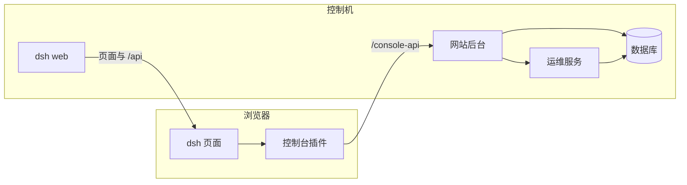

# 控制台前端改为 DeepSeek Harness 插件（dsh-console-plugins）

状态：已确定。本文只描述设计，不包含实现。

调查依据是仓库 `tmp/deepseek-harness` 中的 `deepseek-ai/deepseek-harness`（`0.2.1-alpha.5`，`1517a4db`）。该目录在 `.gitignore` 里，不进入本仓库。

## 1. 背景

策略控制台现在是一套独立的 React 单页应用，由自己的页面入口、整页路由和左侧导航组成，接口走同站的 `/api`。DeepSeek Harness（`dsh`）是另一套完整的网页应用：`dsh web` 注入启动图，浏览器里的界面由 Cordis 客户端插件拼出来。

把 Harness 的前端抽进控制台不可行。它的页面必须由 `dsh web` 注入 `window.__DSH_BOOT__`，界面占满整个文档，并且把 `/api` 留给自己的 RPC 和 WebSocket。

反过来可以：`dsh web` 作为打开页面的主体，控制台按栏目拆成多个客户端插件，嵌在它的框架里。服务器、密钥、交易所、行情、钱包和登录这些数据仍由现在的 Python 网站后台和运维服务提供。

## 2. 目标

- 浏览器打开的是 `dsh web`，不再打开现在这套单页应用。
- 控制台现有栏目拆成多个前端插件，由一个壳插件排成现在的导航和顶部 Tab。
- 面板内部保持现在的白底面板、蓝色竖条标题和表格。
- 插件里的操作继续调用现在的网站后台。网站后台再调用运维服务。浏览器不直接访问运维服务，也不调用交易所。

## 3. 非目标

- 不把网站后台、运维服务或数据库迁进 `dsh` 的 Host 插件。
- 不把控制台接口接到 `dsh` 的 `/api`。
- 不把 Harness 的会话界面抽成控制台里的一块组件。
- 不改交易所只读、不下单、不提币的边界。
- 不在本文里实现插件或改动现有页面。
- 不把对话界面拆成独立插件，再配一个对话代理。它依赖 `dsh web` 注入的启动图，以及宿主进程里的会话流。
- 不把 `dsh-base` 当成可调用的 HTTP 服务。它是 `web` profile 的第一层插件组合，和网页在同一个进程里。
- 不在控制台里重写一套对话界面，也不把整页 `dsh` 嵌进现有单页应用的「军师」栏目。

## 4. 已定决策

| 事项 | 决定 |
| --- | --- |
| 页面主体 | `dsh --profile web`。它负责启动图、插件加载和页面框架 |
| 控制台形态 | 多个客户端插件。每个插件是导出 `apply(ctx)` 的 TypeScript 模块 |
| 导航 | 壳插件以低于默认值的优先级占用左侧栏。默认侧栏优先级是 0，数值更小的那个被画出来 |
| 栏目内容 | 壳插件注册一个主面板，并声明内容槽。各栏目插件往这个槽注册页面 |
| Deepseek Harness | 「军师」里的这个 Tab 切回 `dsh` 自己的会话面板，不另做一套 Harness 界面 |
| 控制台接口 | 挂在同一主机的 `/console-api`。反向代理去掉该前缀后转到网站后台现有的 `/api` |
| `dsh` 接口 | 继续占用页面所在站点的 `/api` 和 `api/remote.mux` |
| 登录 | 使用现有的 `smp_session`。没有会话时打开单独的 `/login`，不加载侧栏；宿主据此放行页面和军师连接 |
| 样式 | 面板内部沿用现有类名。样式表挂在控制台内容根上，不改 `dsh` 的 `body` 和 `--dsw-*` 主题 |
| 运行时 | 插件使用 `dsh` 自带的 React 18，不再打进第二份 React |

## 5. 总体架构

两个进程。`dsh web` 只负责把页面和插件交给浏览器。网站后台和运维服务保持现在的分工：后台保存登录、服务器、密钥、交易所账户和钱包，运维服务负责 SSH、余额和行情。

浏览器里的相对地址 `api/...` 属于 `dsh`。控制台插件只请求 `/console-api/...`。两边的 cookie 名字不同，可以在同一主机上并存。

## 6. 插件划分

壳插件画左侧导航和顶部 Tab，并占住中间内容区。栏目插件不自己做整页路由，只注册自己的页面。

| 插件 | 页面 |
| --- | --- |
| 壳 | 概览、运营、资源这组导航，以及当前栏目的顶部 Tab。军师是这里的侧栏入口，选中 `dsh` 的会话面板 |
| 仪表盘 | 仪表盘空面板 |
| 数字货币 | 概览、行情、交易所、交易策略 |
| 资金账户 | 钱包实例、钱包详情、虚拟信用卡 |
| 服务器 | 服务器实例、登记、详情、终端、密钥 |
| 平台设置 | 登录安全、MCP |

左侧栏在 `dsh` 里是单人座位。壳插件注册上去之后，原来的会话侧栏不再显示，它内部的座位也不会出现在这棵新侧栏里。栏目插件因此只挂到壳插件声明的内容槽，不挂到原来的 `sidebar.panellist`。

主面板的 `conversation` 键留给 `dsh` 会话。壳插件使用另一个键。用户停在控制台栏目时，中间是控制台页面；点「军师 / Deepseek Harness」时，壳插件改选会话面板。

右侧栏保持默认关闭，本方案不往里面放内容。

## 7. 样式

面板内部继续使用现在的结构：`panel`、`panel-head`、蓝色 `mark`、表格、空状态和表单。这些样式只作用于壳插件内容区的根节点。

`dsh` 的外框、字体和明暗色仍由它自己的 `--dsw-*` 变量决定。控制台颜色不跟着那套主题变。顶部 Tab 没有现成的框架座位，由壳插件画在内容区上方，位置和现在的顶栏一致。

## 8. 接口与登录

网站后台的路径和报文保持不变。变化只在浏览器前面的那一层：`/console-api/servers` 转到网站后台的 `/api/servers`，其余路径同样处理。`/mcp` 仍转到网站后台。

本地和正式部署都要让页面与 `/console-api` 出现在同一主机上。网站后台不加跨域。打开页面使用现有的 `smp_session`，不再使用 `dsh` 的启动 token。没有会话时浏览器打开单独的 `/login`，不加载控制台侧栏；登录成功后宿主承认这次会话，页面和军师的连接才可用。退出登录会同时结束这两边。网站后台的登录接口和 `smp_session` 保持不变。控制台的默认账号、两步验证和修改密码仍在「平台设置 / 登录安全」。

运维服务、数据库和密钥解密方式不变。交易所余额和行情仍由运维服务通过 ccxt 读取。

## 9. 部署

控制机在现有网站后台和运维服务之外，再运行一个 `dsh web`。Node 版本按 Harness 的要求，为 `^22.19` 或 `≥24`。对外仍只暴露网站入口。

入口反代做四件事：

- 页面、`dsh` 的静态资源和它的 `/api`、WebSocket 转给 `dsh web`。
- `/console-api/` 去掉前缀后转给网站后台。
- `/mcp` 转给网站后台。
- 转发 WebSocket 的升级头。`dsh` 的接口体上限高于现在站点上 1MB 的限制，这一条路径单独放宽。

`dsh` 默认监听本机 `3080`。不把 `3080` 公布到公网。现在的单页应用不再作为入口构建进网站镜像。

## 10. 第一版不做

- 不把数字货币行情改成 `dsh` 里的实时会话。
- 不把服务器终端改成 `dsh` 的终端侧栏。终端仍走现在的网站后台桥接。
- 不替换 `dsh` 的根框架，也不关闭它的会话能力。
- 不把控制台插件发布到 Harness 的插件市场。插件随这次部署加载。
