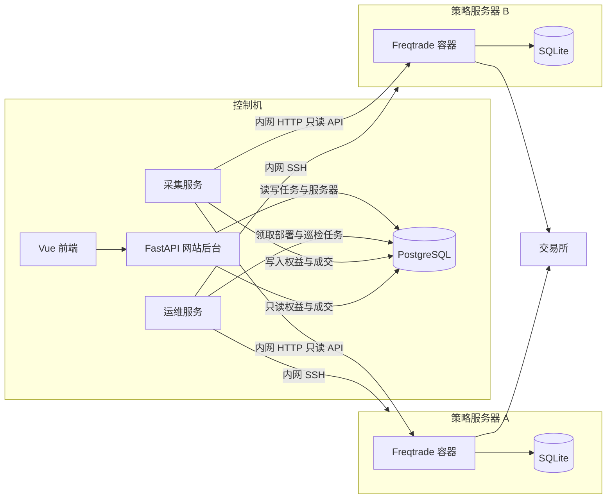

# 策略现状可视化控制台（strategy-console）

状态：待评审。本文只描述设计，不包含实现。

## 1. 背景

个人用 Freqtrade 跑加密货币策略。Freqtrade 自带接口和简易界面，但不适合作为日常看收益、回撤和持仓的控制台。

策略要部署到不同服务器上。这些服务器和放网站的控制机在同一内网。网站用来查看策略收益，也用来登记服务器、把策略用 Docker 部署出去，并查看那台机器上的容器。

网站后台和跑策略的进程必须分开：网站进程崩溃、重启、发布，都不能把已经在远端跑着的策略一起带走。

## 2. 目标

- 在网页上查看一个或多个策略的运行状态、权益曲线、回撤、每日盈亏、当前持仓和历史成交。
- 图表使用现成组件，不自研绘图。
- 登记策略服务器，配置地址和 SSH 登录信息。公网和内网地址都可以。
- 把策略服务用 Docker 部署到选定的服务器上。
- 查看某台服务器上 Docker 部署的容器：名称、镜像、状态、端口。
- 面向个人单用户，先支持模拟盘（dry-run），同一套结构可用于实盘。

## 3. 非目标（第一版）

- 不在网页上向交易所下单，不做提币、划转。
- 不提供网页终端，不在远端容器里执行任意命令。
- 不自研回测引擎。回测继续用 Freqtrade。
- 不做多用户、权限体系和公开 SaaS。
- 不修改 Freqtrade 源码，使用官方镜像。
- 不做在线代码编辑器。策略文件放在控制机的策略目录里，部署时上传。
- 不负责安装操作系统或 Docker Engine。目标服务器需要已经装好 Docker 和 Docker Compose 插件。

## 4. 已定决策

| 事项 | 决定 |
| --- | --- |
| 策略运行时 | Freqtrade 官方镜像，一个策略实例一个 Compose 项目、一个容器 |
| 策略放在哪 | 多台策略服务器。控制机与策略服务器走内网，服务器之间不互访 |
| 远端操作方式 | 独立的运维服务通过 SSH 执行固定的 Docker 命令，不开放任意 shell |
| 网站后台 | Python 3.12 + FastAPI。收益数据只读；服务器与部署走任务表 |
| 网站数据 | PostgreSQL 16 |
| 前端 | Vue 3 + TypeScript + Vite + Vue Router + Pinia |
| 图表 | Apache ECharts（通过 `vue-echarts`） |
| 行情集成 | 采集服务通过内网访问各策略的 Freqtrade API，写入 PostgreSQL |
| 控制机部署 | Docker Compose 跑网站、采集、运维服务和 PostgreSQL。控制机上不跑策略 |

## 5. 总体架构

两台角色。控制机跑网站和采集。策略服务器只跑 Docker 里的 Freqtrade。控制机崩溃时，远端容器由该机器上的 Docker 按重启策略继续跑，不依赖控制机进程活着。



网站后台不直接连接策略服务器，也不调用 Freqtrade。它把「部署」「刷新容器列表」写成任务。运维服务执行 SSH。采集服务只访问 Freqtrade 的 HTTP API，用来采样，不负责部署。

Freqtrade 自己的 SQLite 仍是交易账本，放在该策略容器的数据卷里。PostgreSQL 在控制机上，保存服务器、容器清单、权益和成交副本。

### 5.1 故障域

| 故障域 | 包含 | 崩溃后 |
| --- | --- | --- |
| 网站 | `web-ui`、`web-api` | 页面不可用。运维服务若正在执行已领取的任务，会做完。远端策略继续跑 |
| 运维 | `ops` | 不能新部署、不能刷新容器清单。已启动的远端容器继续跑。采集和收益页面继续 |
| 采集 | `collector` | 收益数据变旧。策略继续交易 |
| 策略 | 某台服务器上的某个 Freqtrade 容器 | 只影响该策略 |

网站容器和策略容器不在同一台 Docker 引擎里，因此网站的 `restart`、重建镜像、删容器都不会作用到策略上。

### 5.2 为什么采集和运维都不进 Freqtrade 进程

Freqtrade 的 HTTP API 和交易循环在同一个进程里。收益查询若打到这个进程上，慢查询和重试会干扰下单。所以采集服务按固定间隔采样，把结果写入 PostgreSQL。网站关闭期间采集仍继续，曲线不会断。

部署和 `docker ps` 走 SSH，由运维服务执行。不把 SSH 放进网站进程：网站请求卡住或进程退出时，不会把一条执行到一半的远端命令和页面绑在一起。SSH 私钥也只出现在运维服务里。

## 6. 组件设计

### 6.1 控制机

控制机用一份 Compose 启动：

| 容器 | 职责 |
| --- | --- |
| `web-ui` | 静态前端 |
| `web-api` | 登录、收益查询、登记服务器、创建部署任务 |
| `ops` | SSH、上传 Compose、执行白名单里的 Docker 命令、回写容器清单 |
| `collector` | 拉取各策略的收益与成交，写入 PostgreSQL |
| `postgres` | 唯一的共享数据 |

### 6.2 策略服务器

每台策略服务器是一台已经能 SSH 登录的内网机器，上面有 Docker Engine 和 Compose 插件。本平台不在网页上安装 Docker。登记服务器时做一次检查，`docker version` 和 `docker compose version` 失败则标记为不可部署。

一个策略对应远程目录 `/opt/smp/strategies/<slug>/`，里面是：

- `compose.yaml`
- `.env`（交易所 Key、Freqtrade API 口令，文件权限 `600`）
- `user_data/`（策略文件与 SQLite）

Compose 约定：

- 项目名 `smp-<slug>`
- 容器名 `smp-<slug>`
- 标签 `smp.managed=true`、`smp.strategy=<slug>`
- `restart: unless-stopped`
- Freqtrade API 只绑定这台机器的内网地址，例如 `<intranet_ip>:<port>:8080`，不绑定到公网
- 数据卷只放在该目录下，不挂到控制机

同一台服务器上的策略端口由控制机分配，避免冲突。策略服务器不连接 PostgreSQL，也不安装网站代码。

### 6.3 运维服务

独立 Python 3.12 进程，单独镜像。它从 `ops_jobs` 表领取任务，同一台服务器同时只跑一个任务，不同服务器可以并行。

允许的远端动作只有下面这些，参数来自任务行，不拼接用户输入进 shell：

| 动作 | 远端命令 |
| --- | --- |
| 检查环境 | `docker version`、`docker compose version` |
| 查看容器 | `docker ps -a --format '{{json .}}'`，再对每个容器 `docker inspect` |
| 部署或更新 | 上传目录后，在该策略目录执行 `docker compose up -d` |
| 启动 / 停止 / 重启 | 仅针对带 `smp.managed=true` 且策略标识匹配的 Compose 项目：`docker compose start`、`stop`、`restart` |
| 日志 | `docker logs --tail 200`，仅限上述受管容器 |

不提供 `docker exec`、不提供自定义 shell、不能删除不受管容器。停止和重启只作用于本平台部署的策略容器。

SSH 约定：

- 使用地址、端口、用户名。地址可以是公网或内网的 IP、IPv6 或主机名。
- 认证优先用私钥。也支持口令登录，因为个人服务器不一定都装了公钥。
- 首次「测试连接」时记录主机密钥指纹，之后不符则拒绝连接。
- 私钥和口令加密后存 PostgreSQL。解密密钥只放在运维服务的环境变量里。API 响应不返回私钥、口令原文，只返回认证方式和对公钥的指纹摘要（口令登录则没有指纹）。

部署步骤：

1. 网站创建策略时选定服务器和策略目录中的策略文件，并写入交易所 Key、Freqtrade API 口令（加密存储）。
2. 插入 `deploy` 任务。
3. 运维服务生成 Compose 和 `.env`，经 SFTP 写到 `/opt/smp/strategies/<slug>/`。
4. 执行 `docker compose up -d`。
5. 成功后把该策略的内网 API 地址写回 `strategies`，状态改为 `running`。采集服务下一轮开始拉数。
6. 失败则保存退出码和截断后的输出，策略状态为 `failed`，不修改远端已有的其他容器。

### 6.4 采集服务

独立 Python 3.12 进程。它读取 `strategies` 里状态为 `running` 的记录，不读取 SSH 信息。

每条策略使用：

- 内网 API 地址（部署成功后写入）
- Freqtrade API 用户名和密码
- 采样间隔，默认 60 秒

采集循环：

1. 调用 `ping`。失败则写心跳 `unreachable`，本轮跳过其余接口。
2. 拉取 `profit`、`balance`、`status`、`daily`、`trades`。
3. 插入权益快照。
4. 按 `(strategy_id, trade_id)` 幂等写入成交。
5. 更新心跳。

单策略超时默认 10 秒。恢复后按最大 `trade_id` 补成交。权益只补采集恢复之后的新点，中断期间不伪造余额。

### 6.5 网站后台

FastAPI。收益、持仓、成交只查询 PostgreSQL。服务器登记、策略部署、刷新容器列表只写业务表和任务表，由运维服务执行。

数据库账号分开：

| 账号 | 权限 |
| --- | --- |
| `web_api` | 读写服务器、策略元数据、任务；只读心跳、权益、成交、容器清单 |
| `ops` | 领取并更新任务；读写容器清单；读取解密所需的密文字段 |
| `collector` | 读取运行中策略的 API 地址和口令密文；写入心跳、权益、成交 |

网站后台不保存交易所 Key 的明文日志，响应里也不回传这些密钥。

### 6.6 前端

Vue 3 单页应用。页面只访问网站后台。

图表用 ECharts：

| 视图 | ECharts 系列 |
| --- | --- |
| 权益曲线、累计收益 | `line` |
| 回撤 | `line` + `areaStyle` |
| 每日盈亏 | `bar`，正负分色 |
| 总览小趋势 | `line`，关闭坐标轴 |

K 线不在第一版。

## 7. 数据模型

时间用 UTC 存储，前端按本地时区显示。密钥字段只存密文。

### 7.1 `servers`

| 字段 | 说明 |
| --- | --- |
| `id` | UUID |
| `name` | 展示名称 |
| `intranet_host` | 服务器地址。可以是公网或内网的 IP、IPv6 或主机名 |
| `ssh_port` | SSH 端口，默认 22 |
| `ssh_user` | SSH 用户 |
| `auth_method` | `private_key` 或 `password` |
| `secret_ciphertext` | 口令的密文。使用密钥登录时为空，私钥放在 `ssh_keys` |
| `ssh_key_id` | 登录用的 SSH 密钥。口令登录时为空 |

### 7.1.1 `ssh_keys`

控制台里的密钥清单。同一把私钥只存一份，多台服务器可以共用。

| 字段 | 说明 |
| --- | --- |
| `id` | UUID |
| `name` | 展示名称 |
| `fingerprint` | 私钥对应公钥的 SHA256 指纹，用来识别是不是同一把钥匙 |
| `secret_ciphertext` | 私钥密文。接口不返回原文 |
| `created_at` | 写入时间 |

登记服务器并选择密钥时，可以选清单里已有的一把，也可以粘贴新私钥。粘贴的新私钥会写入这张表；如果指纹已经存在，就直接复用那一条。
| `host_key_fingerprint` | 测试连接后钉住的主机密钥指纹 |
| `docker_version` / `compose_version` | 最近一次检查到的版本，空表示尚未通过检查 |
| `reachability` | `online` / `offline` / `docker_unavailable` / `unknown` |
| `last_checked_at` | 最近一次 SSH 检查时间 |

### 7.2 `server_containers`

运维服务每次巡检覆盖该服务器的上一份清单。

| 字段 | 说明 |
| --- | --- |
| `server_id` | 外键 |
| `container_id` | Docker 容器 ID |
| `name` | 容器名 |
| `image` | 镜像 |
| `status` | Docker 状态，如 `running`、`exited` |
| `ports` | 端口映射的文本 |
| `managed` | 是否带有 `smp.managed=true` |
| `strategy_slug` | 受管时写入，否则为空 |
| `observed_at` | 这次巡检时间 |

巡检默认每 30 秒一次，页面上可以手动再插一条巡检任务。SSH 失败时保留上一份清单，并在服务器上记下失败原因。

### 7.3 `strategies`

| 字段 | 说明 |
| --- | --- |
| `id` | UUID |
| `server_id` | 部署目标 |
| `slug` | 稳定标识，用作目录名和容器名 |
| `name` | 展示名称 |
| `exchange` | 交易所 |
| `timeframe` | K 线周期 |
| `stake_currency` | 计价币 |
| `dry_run` | 是否模拟盘 |
| `api_base_url` | 内网 API 根地址，部署成功后写入。采集使用，页面不展示口令 |
| `api_username` | Freqtrade API 用户名 |
| `api_password_ciphertext` | Freqtrade API 口令密文 |
| `exchange_key_ciphertext` / `exchange_secret_ciphertext` | 交易所密钥密文。只在部署时由运维服务解密并写入远端 `.env` |
| `host_port` | 绑定在策略服务器内网地址上的 API 端口 |
| `deploy_status` | `pending` / `running` / `stopped` / `failed` |
| `archived` | 归档后不再采集，历史保留 |

### 7.4 `ops_jobs`

| 字段 | 说明 |
| --- | --- |
| `id` | UUID |
| `server_id` | 目标服务器 |
| `strategy_id` | 可空。纯巡检、测试连接时为空 |
| `action` | `test_connection` / `inspect` / `deploy` / `start` / `stop` / `restart` / `logs` |
| `status` | `queued` / `running` / `succeeded` / `failed` |
| `output_excerpt` | 截断后的命令输出，最长约 8 KB |
| `created_at` / `started_at` / `finished_at` | 时间 |

### 7.5 `heartbeats`

| 字段 | 说明 |
| --- | --- |
| `strategy_id` | 外键 |
| `observed_at` | 采集时间 |
| `state` | `running` / `unreachable` / `error` |
| `open_trade_count` | 未平仓数量 |
| `detail` | 短错误信息，可空 |

最新心跳超过 3 个采样间隔时，收益页显示「数据过期」。这表示采集没连上 API，和 Docker 容器是否 `running` 分开显示。容器状态看服务器页的清单。

### 7.6 `equity_snapshots`

| 字段 | 说明 |
| --- | --- |
| `strategy_id` | 外键 |
| `observed_at` | 采样时间 |
| `balance_total` | 账户权益，含未实现盈亏，单位为 `stake_currency` |
| `realized_profit` | 已平仓累计收益 |
| `unrealized_profit` | 未实现收益 |
| `closed_trade_count` | 已平仓笔数 |
| `winning_trade_count` | 盈利笔数 |

索引：`(strategy_id, observed_at)`。

回撤查询时计算：`peak(t)` 为到该点为止的最大 `balance_total`，`drawdown(t) = (balance_total(t) - peak(t)) / peak(t)`，最大回撤是序列最小值。余额为 0 时该点回撤为空。

默认曲线是账户权益。已平仓累计收益另存，供切换。

### 7.7 `trades`

未平仓是 `close_date` 为空的行。

| 字段 | 说明 |
| --- | --- |
| `strategy_id` + `trade_id` | 唯一键。`trade_id` 来自 Freqtrade |
| `pair` / `is_short` | 交易对、是否空头 |
| `open_date` / `close_date` | 开平仓时间 |
| `open_rate` / `close_rate` | 开平仓价 |
| `amount` / `stake_amount` | 数量、投入的计价币 |
| `profit_abs` / `profit_ratio` | 收益。未平仓时为浮动值 |
| `exit_reason` | 平仓原因，未平仓为空 |

## 8. 网站 API

前缀 `/api`。除登录外都要登录态。

### 8.1 会话与收益

| 方法 | 路径 | 说明 |
| --- | --- | --- |
| `POST` | `/api/auth/login` | 账户、密码，开启两步验证时再提交验证码。通过后设置 HttpOnly 会话 Cookie |
| `POST` | `/api/auth/logout` | 清除会话 |
| `GET` | `/api/strategies` | 策略列表：心跳、今日收益、累计收益、未平仓数、部署状态、所在服务器 |
| `GET` | `/api/strategies/{id}` | 策略摘要 |
| `GET` | `/api/strategies/{id}/equity` | 权益与回撤。参数 `from`、`to` |
| `GET` | `/api/strategies/{id}/daily` | 每日已实现盈亏 |
| `GET` | `/api/strategies/{id}/positions` | 未平仓 |
| `GET` | `/api/strategies/{id}/trades` | 历史成交，分页 |

`/equity` 超过约 500 个点时按时间分桶取每桶最后一个点，响应带 `downsampled: true`。

### 8.2 服务器与部署

| 方法 | 路径 | 说明 |
| --- | --- | --- |
| `GET` | `/api/servers` | 服务器列表：地址、可达性、Docker 版本、容器数量 |
| `POST` | `/api/servers` | 登记服务器。提交名称、地址、SSH 端口、用户、私钥或口令 |
| `GET` | `/api/servers/{id}` | 服务器详情。不含密钥原文 |
| `POST` | `/api/servers/{id}/test` | 插入 `test_connection` 任务 |
| `GET` | `/api/servers/{id}/containers` | 最近一次巡检到的 Docker 容器 |
| `POST` | `/api/servers/{id}/inspect` | 插入 `inspect` 任务，立即刷新 |
| `POST` | `/api/strategies` | 创建策略并插入 `deploy` 任务。服务器的 Docker 检查未通过时返回 `409` |
| `POST` | `/api/strategies/{id}/start` | 插入 `start` 任务 |
| `POST` | `/api/strategies/{id}/stop` | 插入 `stop` 任务 |
| `POST` | `/api/strategies/{id}/restart` | 插入 `restart` 任务 |
| `GET` | `/api/strategies/{id}/logs` | 返回该策略最近一次 `logs` 任务的输出；没有则先插入任务 |
| `GET` | `/api/ops-jobs/{id}` | 查询任务状态，供页面轮询 |

创建服务器和创建策略的响应不回传私钥、口令、交易所 Key。

错误：未登录 `401`，不存在 `404`，参数不合法 `422`，Docker 未就绪或主机指纹不符 `409`。

## 9. 页面

### 9.1 登录

使用用户名和密码。用户名可以在「平台设置 / 登录安全」里修改。可以自行开启或关闭两步验证（TOTP）。第一次启动时，若库里还没有账户，用环境变量 `ADMIN_USERNAME`（默认 `admin`）和 `ADMIN_PASSWORD` 创建。两步验证的密钥只在开启时展示一次，页面用这个密钥在本地生成二维码，确认验证码后才生效。

### 9.2 总览 `/`

合计已实现收益、未实现收益、运行中策略数、数据过期数。卡片含名称、所在服务器、模拟盘标记、部署状态、心跳、今日收益、累计收益、未平仓数、近 24 小时权益小图。

合计只加总同一 `stake_currency`。不同币种分组，不做汇率折算。

### 9.3 策略详情 `/strategies/:id`

状态条同时给出两件事：Docker 部署状态，以及采集心跳。指标和图表与收益相关：账户权益、已实现、未实现、胜率、笔数、最大回撤、权益曲线、回撤、每日盈亏、持仓、成交。

可对受管容器执行启动、停止、重启，并查看最近日志。这些按钮只插入任务，完成前按钮进入等待，用任务接口轮询结果。

时间范围默认近 30 天，可选 7 天、90 天、全部。没有快照时显示「尚未采集到数据」。

### 9.4 服务器 `/servers`

列表：名称、地址、SSH 端口、用户、可达性、Docker 版本、最近检查时间。地址不限于内网。

新建表单字段：名称、地址、SSH 端口、用户名、认证方式、私钥或口令。地址可以是公网或内网。保存后执行一次测试连接。测试在运维服务里完成，页面只看任务结果。

### 9.5 服务器详情 `/servers/:id`

一张表列出该机器上 `docker ps -a` 的容器：名称、镜像、状态、端口、是否本平台部署。受管容器可以点进对应策略。

提供「立即刷新」。刷新失败时表仍显示上一份数据，并标出失败时间和原因。Docker 检查未通过时不展示空表冒充「没有容器」，而是显示检查失败原因。

## 10. 网络与密钥

```text
控制机 Compose
  postgres
  web-api
  web-ui
  collector
  ops

策略服务器（每台独立）
  /opt/smp/strategies/<slug>/   由 ops 经 SSH 写入
  容器 smp-<slug>
```

- 控制机公开到办公网的只有网站入口。PostgreSQL 不映射到公网。
- 运维服务到策略服务器：内网 SSH。
- 采集服务到 Freqtrade：内网 HTTP，目标是绑定在策略服务器内网地址上的端口。
- 策略服务器访问交易所走出站。策略服务器不访问控制机的数据库。
- 建议在策略服务器防火墙上，只允许控制机内网 IP 访问 SSH 和策略 API 端口。

| 密钥 | 存放 |
| --- | --- |
| SSH 私钥或口令 | PostgreSQL 密文，仅运维服务能解密 |
| 主机密钥指纹 | `servers.host_key_fingerprint` |
| 交易所 API Key | PostgreSQL 密文；部署时写入远端 `.env`，权限 `600` |
| Freqtrade API 口令 | PostgreSQL 密文；采集服务和远端容器使用 |
| 网站账户密码和两步验证密钥 | PostgreSQL。第一次启动用环境变量创建默认账户，之后在「登录安全」里修改 |
| 数据库口令、字段加密主密钥 | 仅控制机环境变量 |

主密钥不进库。丢失主密钥则已存的 SSH 和交易所密文无法解密，需要重新填写。

建议目录（实现阶段再用，本次不创建代码）：

```text
apps/web-api/
apps/web-ui/
apps/collector/
apps/ops/
deploy/compose.yaml          只包含控制机
strategies/                  控制机上的策略文件目录，部署时上传
```

## 11. 故障隔离

| 故障 | 远端策略 | 采集 | 网站与部署 |
| --- | --- | --- | --- |
| `web-api` 或 `web-ui` 崩溃 | 继续。Docker 重启策略不依赖网站 | 继续 | 页面不可用。已在 `running` 的运维任务继续 |
| `ops` 崩溃 | 已启动的容器继续 | 继续 | 新部署和刷新停住，恢复后接着领 `queued` 任务 |
| SSH 或内网中断 | 该服务器上的容器继续交易 | 对应策略心跳变为 `unreachable` | 该服务器显示离线，保留上一份容器清单 |
| `collector` 崩溃 | 继续 | 中断，恢复后补成交 | 收益页数据过期。容器清单仍可刷新 |
| PostgreSQL 不可用 | 继续 | 写入失败并重试 | 网站与新任务失败 |
| 单个 Freqtrade 容器退出 | 仅该策略停止。`unless-stopped` 会按 Docker 的策略重启非手动停止的容器 | 该策略 `unreachable` | 服务器页能看到 `exited` 或 `restarting` |
| 控制机断电 | 策略服务器上的容器继续 | 停止 | 停止。控制机恢复后不需要先启动策略 |
| 策略服务器断电 | 该机容器停止。来电后由 Docker 按重启策略拉起 | 期间 `unreachable` | 其他服务器不受影响 |

手动停止是 `docker compose stop`，不会被 `unless-stopped` 立刻拉起。这和进程崩溃不同。

## 12. 实现顺序

评审通过后再写代码：

1. 控制机 Compose 启动 PostgreSQL、运维服务、采集服务。此时可以没有网站。
2. 用一张任务把一个 dry-run 策略部署到一台内网服务器，确认容器在该机 `docker ps` 中，且控制机进程全部停掉后容器仍在。
3. 采集写入权益。网站未启动时采集仍进行。
4. 实现收益只读 API 和服务器、任务 API。
5. 实现总览、策略详情、服务器列表和容器表。
6. 再部署到第二台服务器，确认总览能同时看到两边的策略，一台 SSH 失败不影响另一台。

## 13. 相对上一版的变化

- 策略从「和控制机同一份 Compose」改为「经 SSH 部署到多台内网服务器上的 Docker」。
- 网页可以登记服务器、部署策略、查看容器，以及启停本平台部署的策略容器。
- 仍然不能在网页上下单或打开远端 shell。收益数据路径不变：采集服务写 PostgreSQL，网站只读。
